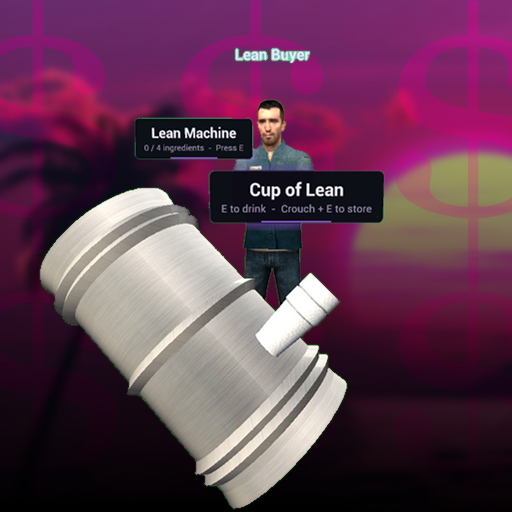

<div align="center">
    
</div>

# Lean Machine

A simple lean making, drinking, and selling mechanic for the DarkRP gamemode in Garry's Mod. Players brew cups of lean by mixing ingredients in a lean machine, then drink them or sell them for profit.

## Features

- **Lean Machine:** mix candy, sprite, ice, and codeine into a cup of lean
- **Lean Cup:** interact with a cup to drink it and become intoxicated, or crouch and interact to store it
- **Lean Buyer:** a standalone entity that buys your stored cups of lean
- **Haggling:** haggle with the Lean Buyer for a better price, but if he rejects your offer, you may be punished
- **Configuration:** change the core settings in-game through the Q menu

## Installation

### Steam (Recommended)

Subscribe to [Lean Machine on the Steam Workshop](https://steamcommunity.com/sharedfiles/filedetails/?id=3834765811) and add it to your server's collection.

### Manual

1. Clone this repo into your `garrysmod/addons` folder
2. Edit any config in `/lua/leanmachine/sh_config.lua`
3. Restart your server

## Usage

### Server Admins

1. Add the Lean Machine to the F4 menu. You can either:
   - Toggle it in-game under Utilities > Lean Machine > Settings > DarkRP
   - Set `Register` in `sh_config.lua`:

     ```lua
     C.DarkRP = {
         Register = true,
         ...
     }
     ```
   - Add it manually to your DarkRP entities
2. Spawn Lean Buyers around your map from the Entities tab
3. Adjust any other settings in-game via the Utilities tab

### Players

1. Buy a Lean Machine
2. Interact with the machine to open the menu
3. Mix in all the necessary ingredients
4. Pour out a cup to drink or sell